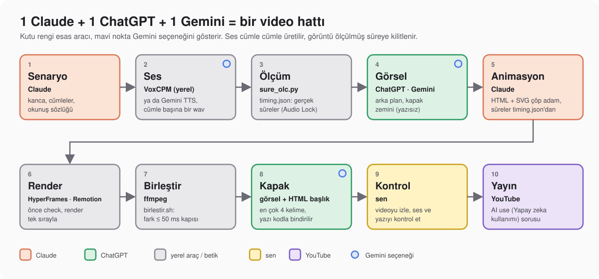
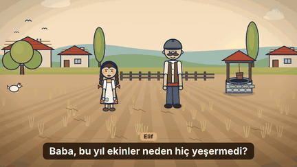

# Yapay zekâ ile video üretimi: 1 Claude + 1 ChatGPT + 1 Gemini

Üç aboneliği tek bir video hattında birleştiriyoruz ve bu düzeni kendi videolarımızda kullanıyoruz. **Claude yönetir ve kodlar**: senaryoyu yazar, her cümleye duygu atar, animasyonu HTML olarak kodlar, süreleri ölçer, parçaları birleştirir. **Ses modeli seslendirir** (yerelde VoxCPM ya da Gemini TTS). **ChatGPT ve Gemini görsel üretir** (arka plan, kapak zemini). Çıkan şey tek bir MP4.

Bu repo hattın kendisidir: iki skill, alt ajanlar, betikler ve adım adım komutlar. Skill'leri ve ajanları kopyala, Claude Code'a konunu söyle.

[](https://www.youtube.com/watch?v=Y1uh7mrCT4Y)

*Yerelde ücretsiz TTS kurulumunu anlattığımız video (VoxCPM). Bu repo onun devamı: sesten videoya tüm hat.*



## Örnek çıktı


Tam kalite: [demo/video.mp4](demo/video.mp4)

6 cümle, 23,4 saniye. Ses yerel VoxCPM'de üretildi: tarifle oluşturulan sesin ilk cümlesi referans yapılıp kalan cümleler o referansla üretildi (kilit yöntemi: [`ses.md`](skills/video-hatti/ses.md)). Sahneler kodla çizilmiş SVG; görsel modeli kullanılmadı. Animasyon HyperFrames 0.8.184 ile render edildi. Toplam ses-görüntü süre farkı 7 ms, yani 50 ms kapısının altında. Girdiler ve ara dosyalar [`demo/`](demo/) klasöründe: `cumleler.txt`, `timing.json`, `ses/` ve `animasyon/` (kaynak proje ile `sahne_uret.py`).

### İkinci örnek: karakterleri değiştir



Tam kalite: [demo-koy-sahnesi/video.mp4](demo-koy-sahnesi/video.mp4)

Aynı hat, başka karakterler: köylü kız Elif ve babası, 5 cümle, 13,3 saniye, iki ayrı ses. Her konuşmacının ilk cümlesi tarifle üretildi ([`sesler.json`](demo-koy-sahnesi/sesler.json)), kalan cümleler o kayıt referans alınarak üretildi. Ağız açıklığı hece sayısından değil, ses dosyasının gerçek şiddetinden gelir; konuşmayan karakter gülümser. Karakterler, kuyu, tarla ve tavuk kodla çizilmiş SVG'dir (görsel modeli yok). Claude'a "kızı nine, babayı torun yap" demen yeterli: `sahne_uret.py` içindeki `kiz_ciz` ve `baba_ciz` işlevlerini o değiştirir. Ses-görüntü süre farkı 20 ms, 50 ms kapısının altında.

## Kim ne yapar

| Araç | Rolü | Neden |
|---|---|---|
| **Claude (Claude Code)** | Yönetmen + kodcu: senaryo, cümleler, duygu ve stil talimatları, HTML/SVG animasyon, ölçüm, birleştirme, alt ajanları yönetme | Kod yazmada ve çok adımlı işi yürütmede en iyisi; raster görsel ve ses dosyası üretmez |
| **`video-hatti` skill'i** | Hattı baştan sona yürütür: 10 istasyon, değişmez kurallar, alt ajan dağılımı | Konuyu söylemen yeter |
| **`ses-yonetmeni` skill'i** | Metni cümlelere böler, her cümleye duygu/hız/vurgu/duraklama atar (`sahneler.json`) | Her cümleye duygu talimatı yazar; sonucu dinleyerek doğrularsın |
| **VoxCPM (yerel)** | Ses: kendi sesinin klonu, tarifle ses, diyaloglar, stil talimatıyla duygu. Kurulum: [`skills/video-hatti/voxcpm.md`](skills/video-hatti/voxcpm.md) | Ek ücret yok, kota yok |
| **Gemini TTS** (AI Studio / API) | Ses: hazır sesler, Türkçe destekli; kendi sesini çoğaltma (Voice Replication, ücretli katman) | Model indirmez; küçük bir Python ortamı + API anahtarı yeter; hazır seslerde ücretsiz katman var (ücretsiz katmanda içerik Google ürünlerini geliştirmede kullanılabilir) |
| **ChatGPT** (Codex CLI ile ya da uygulamadan) | Görsel: arka plan, kapak zemini | `gpt-image-2` ile temiz görsel |
| **Gemini / Antigravity** (uygulamadan) | Görsel: arka plan, kapak zemini | Nano Banana ile ikinci görsel kaynağı |
| **HyperFrames / Remotion** | HTML/React → MP4 render | Claude'un yazdığı animasyonu video yapar |

Claude çöp adamı ve hareketi SVG ile çizer; sesi ses modeli, fotoğraf gibi arka planı görsel modeli üretir. Hattın temel fikri bu.

## Önce hazırla

- **Claude Code** (Claude aboneliği)
- **Node.js 22+** ve **ffmpeg** (render ve birleştirme)
- **Python 3.11** (VoxCPM ortamı için) ve komutlarda `python3`
- Ses için biri: yerel **VoxCPM** ([kurulum](skills/video-hatti/voxcpm.md)) ya da bir **Gemini API anahtarı** ([AI Studio](https://aistudio.google.com/apikey))
- Görsel için biri: **Codex CLI** (ChatGPT girişi) ya da ChatGPT/Gemini uygulaması

## Hızlı başlangıç

```bash
git clone https://github.com/timhatipoglu/yapay-zeka-ile-video-uretimi
cd yapay-zeka-ile-video-uretimi

# iki skill (video-hatti + ses-yonetmeni) ve alt ajanlar: tüm projelerde kullanılsın
mkdir -p ~/.claude/skills ~/.claude/agents
cp -R skills/* ~/.claude/skills/
cp ajanlar/*.md ~/.claude/agents/

# video yapacağın projeye betikleri kopyala; komutları o klasörde çalıştır
cp -R scripts /yol/projen/
cd /yol/projen

# yerel VoxCPM kullanacaksan, kurduğun ortamı etkinleştir (her yeni terminalde bir kez)
source /yol/VoxCPM/.venv/bin/activate
```

Ortam etkinken `python3` o ortamın Python'unu verir; bu yüzden tüm komutlarda `python3` yaz.

Claude Code'u proje klasöründe aç ve şunu yaz:

> `video-hatti` skill'ini kullan. Konu: "İstanbul vapuru ve martılar", 90 saniye, Türkçe. Anlatıcı sesi benim klonum (`referans/ben.wav`, yazısı `referans/ben.txt`), yerel VoxCPM ile üret. Arka planları ChatGPT ile üret, çöp adamı SVG olarak sen çiz, HyperFrames ile render et, birleştirmede ses-görüntü farkı 50 ms'yi geçmesin.

Duygulu okutmak için tek cümle eklemen yeter:

> Anlatıcı `ses-yonetmeni` ile okusun: giriş sakin, doruk heyecanlı, son cümle üzgün.

Skill hattı sırayla yürütür; ses, görsel ve render için alt ajanları çağırır.

## Hat, adım adım

Hat 10 istasyondur (şemadaki sırayla). Tüm komutlar **proje kökünden** çalışır. `(cd animasyon && ...)` gibi parantezli satırlar komutu alt kabukta o klasörde çalıştırır; bulunduğun klasör değişmez:

```
proje/
  cumleler.txt             # ya da sahneler.json (stilli satırlar)
  sesler.json  okunus.json # konuşmacı sesleri, okunuş sözlüğü
  referans/                # klon için kayıt: ben.wav, ben.txt (isteğe bağlı; en az 5 sn temiz kayıt)
  ses/                     # cümle başına bir .wav
  timing.json              # ölçülmüş süreler
  gorseller/               # arka plan görselleri
  animasyon/               # HyperFrames projesi
  remotion/                # Remotion kullanırsan onun projesi (çıktı: remotion/out/video.mp4)
  kapak/                   # kapak projesi
  scripts/
  video.mp4                # son çıktı
```

İki terim: **sahne** bir mekândır (bir arka plan birimi), **segment** `timing.json`'daki bir cümle satırıdır. Bir sahnede birçok segment olur. (`sahneler.json`'un her öğesi bir segmenttir.)

HyperFrames komutlarını `0.8.184` sürümüne sabitledik: demoyu bu sürümle ürettik. Yeni bir sürümde komutları `npx hyperframes@<sürüm> --help` ile doğrula.

### 1. Senaryo

Claude tam cümlelerden oluşan `cumleler.txt` yazar. İlk cümle videonun değerini söyler (kanca). Diyalog varsa satırlar `ece: Nereye gidiyoruz?` biçiminde olur. Yabancı terimlerin okunuşu `okunus.json`'a yazılır (`{"Claude": "Klod"}`); altyazıda özgün yazım kalır. Her cümlenin hangi mekânda geçtiği de çıkarılır: arka plan sayısı mekân sayısı kadardır, cümle sayısı kadar değil.

### 2. Ses (cümle cümle)

Girdi `.txt` (her satır `[ad: ]cümle`) ya da `.json` (`sahneler.json`) olur.

```
anlatici: Sabah vapuru iskeleden ayrılırken martılar peşinden gelir.
ece: Dede, bu vapur nereye gidiyor?
```

```bash
# yerel VoxCPM (ortam etkinken): cümle listesi
python3 scripts/voxcpm_diyalog.py cumleler.txt ses/ --sesler sesler.json --okunus okunus.json

# duygu/stil taşıyan sahneler.json ile
python3 scripts/voxcpm_diyalog.py sahneler.json ses/ --sesler sesler.json --okunus okunus.json

# önce kontrol: model yüklemeden satırları ve ses tanımlarını doğrular
python3 scripts/voxcpm_diyalog.py sahneler.json ses/ --sesler sesler.json --kuru

# yalnız 3. ve 7. cümleyi yeniden üret (1 tabanlı sıra numarası)
python3 scripts/voxcpm_diyalog.py sahneler.json ses/ --sesler sesler.json --sadece 3,7
```

Gemini TTS için ayrı, küçük bir ortam kur (Homebrew Python'da ortamsız `pip install` reddedilir):

```bash
python3 -m venv .venv-gemini && source .venv-gemini/bin/activate
pip install "google-genai>=2.25.0,<3"
export GEMINI_API_KEY=...
python3 scripts/gemini_tts.py cumleler.txt ses/ --ses anlatici=Kore --ses ece=Puck --stil "sakin, net"
python3 scripts/gemini_tts.py sahneler.json ses/ --ses anlatici=Kore   # satır stili speech_metadata.style olarak gider
```

Çıktı: `ses/001_anlatici.wav`, `ses/002_ece.wav` ... Var olan dosya atlanır; yeniden üretmek için `--yeniden` ya da `--sadece`. Yol seçimi, klon hazırlığı, `sesler.json` örneği, fiyat ve kota ayrıntısı: [`skills/video-hatti/ses.md`](skills/video-hatti/ses.md).

**Tarifle ses her çağrıda yeniden örneklenir.** Aynı İngilizce tarifle iki çekimde ölçtüğümüz perde 149 Hz ve 213 Hz oldu: iki ayrı kişi gibi. Kalıcı bir ses için ilk cümleyi tarifle üret, beğendiğini referans yap (`sesler.json`'da `reference`, VoxCPM'in `reference_wav_path` parametresi; istersen yazısıyla birlikte `prompt_wav` + `prompt_text`), kalan cümleleri o referansla üret. Üç adımlı yöntem `ses.md`'de.

#### Duygulu seslendirme

Tekdüze anlatıcı videoyu öldürür. **Claude metni cümlelere (segmentlere) böler, hikâyenin gerilim eğrisine bakar ve her cümleye duygu, hız, vurgu ve duraklama atar**; bunu [`ses-yonetmeni`](skills/ses-yonetmeni/SKILL.md) skill'i yapar. Bu işlerin hepsini Claude doğrudan yapar: sen tek cümleyle ("giriş sakin, doruk heyecanlı, son üzgün") söylersin, skill her cümleye bir duygu talimatı yazar; talimatın sese gerçekten yansıyıp yansımadığını dinleyerek sen doğrularsın. Sonucu `sahneler.json`'a yazar:

```json
[
  {"konusmaci": "anlatici", "metin": "Her şey sıradan bir sabah başlamıştı.",
   "stil": "Warm, calm storytelling voice with gentle pacing", "sonra_ms": 250},
  {"konusmaci": "anlatici", "metin": "Ama birden kapı açıldı! İnanamıyorum!",
   "stil": "Speaking with excitement, surprised, a bit faster", "sonra_ms": 150},
  {"konusmaci": "anlatici", "metin": "Fakat artık çok geçti.",
   "stil": "Speaking sadly with a trembling voice, slow", "sonra_ms": 600}
]
```

`stil` İngilizce seslendirme talimatıdır, `metin` Türkçe kalır. `sonra_ms` cümleden sonra ses dosyasının içine sessizlik ekler; `timing.json` bu süreyi zaten içerir. Sık kullanılan duygular:

| Duygu | Talimat |
|---|---|
| Heyecanlı | `Speaking with excitement and enthusiasm` |
| Üzgün | `Speaking sadly with a trembling voice` |
| Öfkeli | `Speaking angrily with a raised voice` |
| Fısıltı | `Whispering softly and mysteriously` |
| Masal anlatıcısı | `Warm, expressive storytelling with dramatic pauses` |

- Bunlar doğal dil talimatıdır, modelin sabit kodu değil. Türkçe metinde etkisini dinleyerek test et; işe yaramazsa kelimeyi değiştir.
- **Stilli satırı hafif tut ve her birini doğrula.** Türkçe metinle yaptığımız VoxCPM2 ölçümünde `whispering, slow and mysterious` talimatı tam klon (prompt) kipinde sesli okundu; yalnız referans kipinde okunmadı ama ses kimliği uzaklaştı (tını mesafesi 0,52, bizim kabul eşiğimiz 0,42; perde %21 pes). Bu yüzden her stilli satırı dinle, Whisper gibi bir transkriptle talimatın metne sızmadığını doğrula; kayma varsa stili yumuşat ya da o satırı stilsiz üret.
- Stil alanı iki motorda da var, ama girişi farklı: VoxCPM metnin başına parantezli talimat alır (`(stil)metin`), Gemini `speech_metadata.style` alanını kullanır. VoxCPM'de tam klon (`prompt_wav` + `prompt_text`) stil kullanamaz: stilli satır `reference` ile ya da tarifle (`design`) üretilir; stilsiz satırlar tam klonla gider.
- **Satır içi etiketler motora özgüdür.** Aynı `sahneler.json` iki motorda çalışır, ama etiketler motora göre yazılır. VoxCPM kare parantez kullanır: `[laughing]`, `[sigh]`, `[Uhm]`, `[Shh]`, `[Question-ah]`, `[Surprise-wa]`, `[Dissatisfaction-hnn]`; seyrek kullan, bir cümlede birden fazla yığma. Gemini 3.8 TTS açı parantez kullanır; belgedeki etiketler `<short pause>`, `<long pause>`, `<sigh>`, `<laugh>`, `<cough>`, `<gasp>`, `<breath>`, belge örneği: `Wait... <short pause> did you hear that? <sigh>`. Türkçe metinde etiketin nasıl çıktığını her iki motorda da dinleyerek doğrula.
- Süre yine sesten gelir: duygu hızı değiştirir, animasyon duygu atandıktan **sonra** ölçülen süreye göre kurulur.

Tüm kurallar ve duygu tablosu: [`skills/ses-yonetmeni/SKILL.md`](skills/ses-yonetmeni/SKILL.md).

### 3. Ölçüm: video süresi sesten gelir

```bash
python3 scripts/sure_olc.py ses/ timing.json
```

`timing.json` her segmentin (cümlenin) gerçek süresini ve başlangıç/bitişini yazar. Animasyonun her segmenti bu süreden kurulur; aynı mekândaki segmentler aynı arka planı paylaşır. Süreyi cümle sayısına bölmeyiz: görüntü sesten kopar. 0,8 sn'den kısa cümle (yutulmuş olabilir) ve 20 sn'den uzun cümle uyarı alır.

### 4. Görsel

Claude görsel (raster) üretemez; arka planı ve kapak zeminini ChatGPT ya da Gemini üretir. Görsel sayısı mekân sayısı kadardır: bir sahne = bir arka plan.

```bash
# Codex CLI + ChatGPT girişi
curl -fsSL https://chatgpt.com/codex/install.sh | sh
codex login
codex exec --skip-git-repo-check --ephemeral -C "$PWD" -s workspace-write --color never \
  "\$imagegen ile <tarif> görselini üret." < /dev/null
# -C yalnız çalışma klasörüdür. Görsel ~/.codex/generated_images altına düşer (CODEX_HOME tanımlıysa onun altına);
# yeni PNG'yi gorseller/ altına kopyalarsın. gorsel-ajani bu kopyayı kendisi yapar.
```

`gorsel-ajani` bunu senin yerine yapar: üretir, `gorseller/` altına kopyalar, açıp bakar. CLI kurmak istemeyenler tarifleri ChatGPT ya da Gemini uygulamasına yapıştırıp görseli klasöre koyar. Tarif şablonu, kapak ve yollar: [`skills/video-hatti/gorsel.md`](skills/video-hatti/gorsel.md).

### 5. Animasyon (HTML)

Claude her sahneyi HTML + SVG + GSAP olarak yazar: çöp adam SVG, arka plan görsel dosyası, altyazı HTML. Segment süreleri `timing.json`'dan gelir.

```bash
HYPERFRAMES_SKIP_SKILLS=1 npx hyperframes@0.8.184 init animasyon --non-interactive --skip-skills
mkdir -p animasyon/assets && cp gorseller/*.png animasyon/assets/   # HTML'de assets/arka.png diye okunur
(cd animasyon && npx hyperframes@0.8.184 check --json)              # yazarken tek başına kontrol
```

`--non-interactive` etkileşimli sihirbazı kapatır. 0.8.184'te `--skip-skills` bayrağı geçici olarak yok sayılıyor; `init`'in skill kontrolünü `HYPERFRAMES_SKIP_SKILLS=1` kapatır. HyperFrames medyayı proje içindeki `assets/` altından okur, bu yüzden görselleri oraya kopyala. Ses projeye girmez: sesi 7. adımda birleştirme betiği ekler. `init` projeye `AGENTS.md` ve `CLAUDE.md` yazar; kendi talimatlarınla çakışmasın diye gözden geçir ya da sil.

Remotion kullanacaksan projeyi proje kökünde `remotion/` alt klasörüne kur: `npx create-video@latest --yes --blank remotion`. Remotion belgesi macOS 15 (Sequoia) ve üzerini şart koşar. İkisinin karşılaştırması, çöp adam ve altyazı: [`skills/video-hatti/animasyon.md`](skills/video-hatti/animasyon.md).

### 6. Render

`check` ile `render` zincirlenir: `check` hata verirse render hiç başlamaz.

```bash
(cd animasyon && npx hyperframes@0.8.184 check --json && npx hyperframes@0.8.184 render --quality looks -o render.mp4)
# Remotion: (cd remotion && npx remotion render src/index.ts MyComposition out/video.mp4)
# MyComposition yer tutucudur: kompozisyonun kimliğini yaz (boş şablonda MyComp)
```

Çıktı `animasyon/render.mp4` olur (Remotion'da `remotion/out/video.mp4`). Render'ları tek sırayla al; aynı anda birden çok render açma.

### 7. Birleştir

```bash
./scripts/birlestir.sh ses animasyon/render.mp4 30 video.mp4
# Remotion: ./scripts/birlestir.sh ses remotion/out/video.mp4 30 video.mp4
```

Betik ses dosyalarını sırayla birleştirir, cümleler arası ses seviyesini eşitler (`SES_DENGELE=0` ile kapanır), görüntüye ekler ve süre farkını ölçer. **50 ms'den fazla fark çıkarsa hata verir**: animasyonu `timing.json`'a göre yeniden kurarsın. Kapı toplam süreyi ölçer; segment süreleri `timing.json`'dan kurulduğu için ayrıca doğrulanmaz. Kapı geçmezse `video.mp4` yazılmaz (var olan dosyaya da dokunulmaz).

### 8. Kapak

Zemini yazısız ChatGPT/Gemini'den iste (`gorseller/kapak_zemin.png`); başlığı (en çok 4 kelime) HTML ile bindir. Yazı net olur ve doğru yazılır. `kapak/`, ana videodan ayrı, 2 sn'lik tek kompozisyonlu bir HyperFrames projesidir: Claude `index.html`'i 1280x720 yazar (zemin ``, başlık `<div>`). Ekran görüntüsü:

```bash
HYPERFRAMES_SKIP_SKILLS=1 npx hyperframes@0.8.184 init kapak --non-interactive --skip-skills
mkdir -p kapak/assets && cp gorseller/kapak_zemin.png kapak/assets/
npx hyperframes@0.8.184 snapshot kapak --at 1.0 --no-end --describe false -o kapak/out
cp kapak/out/frame-00-at-1s.png kapak/kapak.png   # 1280x720 PNG
```

`--describe false`: ortamda `GEMINI_API_KEY` varsa `snapshot` görüntüyü Gemini'ye göndermesin.

### 9. Kontrol

Videoyu baştan sona izle: altyazı, ses seviyesi, ekrandaki yazı hataları. Şüpheli cümleleri ve rastgele iki ses dosyasını dinle; ölçüm tonu ve telaffuzu yakalamaz. Beğenmediğin her şeyi tarihiyle `begenilmeyenler.md`'ye yaz.

### 10. Yayın

Yüklerken YouTube Studio'daki **AI use** sorusunu (Attributes bölümü; Türkçe arayüzde "Yapay zeka kullanımı") doğru yanıtla. Yalnız gerçekçi görünen yapay zekâ içeriği bildirilir: gerçek birine söylemediği şeyi söylettiren ses ya da görüntü, gerçek bir olay ya da yerin değiştirilmiş görüntüsü, yaşanmamış gerçekçi bir sahne, ana odağı yapay zekâ müziği olan video. Çöp adam animasyonu gibi gerçekçi olmayan içerik ile kendi sesinin klonuyla yapılan seslendirme ya da dublaj bildirim gerektirmez. Başkasının sesini klonladıysan (izinle bile) "Evet" de. Kural zamanla değişir; yüklemeden önce [YouTube yardımını](https://support.google.com/youtube/answer/14328491) oku.

## Skill ve alt ajan kullanımı

### Skill

`skills/` altında iki Claude Code skill'i var: `video-hatti` hattı yürütür, `ses-yonetmeni` duygu, hız, vurgu ve duraklamayı atar. Claude oturum başında her skill'in yalnız **adını ve açıklamasını** bağlama alır (açıklama başına en çok 1.536 karakter; çok skill varsa liste bağlam penceresinin %1'lik bütçesine sığsın diye bazı açıklamalar kırpılır). Gövdesi ve yan dosyalar (`ses.md`, `voxcpm.md`, `gorsel.md`, `animasyon.md`, `atolye.md`) skill çağrılınca ve ihtiyaç oldukça yüklenir. Çağrılan `SKILL.md` konuşmada kalır; `/compact` sonrası skill başına ilk 5.000 token (toplam 25.000) yeniden eklenir. Bu yüzden skill eklemek ucuzdur ama bedava değildir; asıl maliyet uzun oturumlardır. Çağırmak için `/video-hatti` ya da `/ses-yonetmeni` yaz ya da konuyu anlat, Claude açıklamaya bakıp kendisi açar.

Kurulum yerleri:

| Yer | Kapsam |
|---|---|
| `~/.claude/skills/video-hatti/` ve `~/.claude/skills/ses-yonetmeni/` | tüm projelerin |
| `<proje>/.claude/skills/video-hatti/` ve `<proje>/.claude/skills/ses-yonetmeni/` | yalnız o proje (git'e eklenebilir) |

### Alt ajanlar

Alt ajan, kendi bağlamında çalışan ve ana konuşmaya yalnız sonucu dönen bir yardımcıdır. Uzun günlükleri (render, üretim) ana oturumdan uzak tutar ve işe uygun **daha ucuz** modeli seçmeni sağlar. `ajanlar/*.md` dosyalarını `~/.claude/agents/` altına kopyala.

| Ajan | Model | İş |
|---|---|---|
| [`ses-ajani`](ajanlar/ses-ajani.md) | haiku | `cumleler.txt` ya da `sahneler.json` dosyasını seslendirir, ölçer, şüpheli cümleleri listeler |
| [`gorsel-ajani`](ajanlar/gorsel-ajani.md) | sonnet | Codex `$imagegen` ile bir görsel üretir, açıp bakar |
| [`render-kosucu`](ajanlar/render-kosucu.md) | haiku | `animasyon/` projesinde `check` + `render`, yalnız özeti döner |

Model dağılımı:

- **Basit, mekanik iş** (ölçüm, render, komut çalıştırma, günlük özetleme): **haiku**
- **Orta iş** (görsel kontrolü, kısa araştırma, metin düzeltme): **sonnet**
- **Zor ve kod ağırlıklı iş** (senaryo yapısı, animasyon kodu, hata ayıklama): **ana oturum, opus**

Ajanın modeli dosyanın başındaki `model:` alanıyla belirlenir. Sıra: çağrıdaki `model` parametresi, dosyadaki `model:`, `CLAUDE_CODE_SUBAGENT_MODEL` ortam değişkeni, ana oturumun modeli. `CLAUDE_CODE_SUBAGENT_MODEL_FORCE=1` açıksa dosyadaki `model:` yok sayılır ve tek model zorlanır. Model seçimi ve token ekonomisi için ayrı rehberimiz: [claude-code-game-studios-rehber](https://github.com/timhatipoglu/claude-code-game-studios-rehber).

Bağlamı izlemek için Claude Code'da `/context`, modeli değiştirmek için `/model` kullan. Başka bir işe geçerken `/clear` bağlamı sıfırlar; aynı işe devam ederken `/compact` konuşmayı özetleyip yer açar (silmez).

## Atölye düzeni: ajanları yan yana çalıştırmak

Ajan eklemek kolay; zor olan birbirinin işini bozmadan çalıştırmak. Bizi hızlandıran ajanlar değil, etraflarındaki düzen:

- **Tek şef:** konuştuğun tek oturum; alt ajanlar ona bağlı.
- **Önce pano haritası:** senaryoyu bölümlere ayır, her bölüm için "yalnız dinleyen anlar mı?" diye sor; anlamıyorsa ekranda ne görüneceğini yaz.
- **Devir dosyaları:** ajanlar konuşarak değil dosya bırakarak bilgi aktarır. Teslim notu yoksa iş bitmemiştir.
- **Kapılar:** her istasyonun çıkışında kontrol. Ses-görüntü farkı > 50 ms ise birleştirme reddeder; `check && render` zincirinde `check` hata verirse render başlamaz.
- **Aynı hata ikinci kez olursa nota değil koda yaz.** Kapı unutulmaz.
- **Kod paralel, render sıralı.**
- **Marka kilidi:** karakter kartı, yasak listesi, renk kodları ve onaylı görsellerin kütüphanesi.

Tamamı, dosya düzeniyle birlikte: [`skills/video-hatti/atolye.md`](skills/video-hatti/atolye.md).

## Hazır skill'ler ve araçlar

Aşağıdakiler hattı güçlendirir. Topluluk skill'lerini kurmadan önce `SKILL.md` dosyalarını oku; kurulum komutları sık değişir, repo sayfasındaki güncel komutu kullan.

| Ne | Ne işe yarar | Kurulum | Not |
|---|---|---|---|
| [HyperFrames](https://github.com/heygen-com/hyperframes) | HTML → MP4, Claude Code skill'leriyle | `npx hyperframes@0.8.184 skills update` (CLI sürümüne eşleşen çekirdek skill'leri kurar; en kolay yol) ya da Claude Code eklentisi: `claude plugin marketplace add heygen-com/hyperframes` ardından `claude plugin install hyperframes@hyperframes` (çağrı adı `/hyperframes:hyperframes`). Seçici istersen `npx skills add heygen-com/hyperframes` | Apache-2.0; bazı skill'ler (`/reverse-any-video`, `/style-sampling`) ücretli Pro ister. CLI ve skill'ler telemetri gönderir (komut adı, render süresi, sistem bilgisi); HeyGen hesabıyla giriş yaparsan kullanım hesabına bağlanır. Kapatmak için `npx hyperframes@0.8.184 telemetry disable` ya da `DO_NOT_TRACK=1`. Eklenti ile bağımsız kurulumu birlikte tutma: iki kopya yüklenir, çağrı adları da farklıdır; birini seç |
| [Remotion skill'leri](https://github.com/remotion-dev/skills) | React ile video; Claude için en iyi uygulama kuralları | `npx skills add remotion-dev/skills` | Remotion lisansı: bireyler ve küçük şirketler ücretsiz, büyük şirketler lisanslı |
| [anthropics/skills](https://github.com/anthropics/skills) | `canvas-design`, `algorithmic-art`, `slack-gif-creator`, `web-artifacts-builder`, `frontend-design` | `/plugin marketplace add anthropics/skills`, sonra `/plugin install example-skills@anthropic-agent-skills` | Kapak ve görsel tasarımda işe yarar |
| [greensock/gsap-skills](https://github.com/greensock/gsap-skills) | GSAP animasyon kuralları (HyperFrames'in animasyon dili) | repo sayfasındaki komut | MIT |
| [kajisho5/ffmpeg-skill](https://github.com/kajisho5/ffmpeg-skill) | ffmpeg ile yerel video düzenleme: 42 araç (kes, birleştir, altyazı yak, ses seviyesi, teslim kontrolü), önce ölç sonra doğrula iş akışı; MCP sunucusu olarak da çağrılır | `npx ffmpeg-skill`, sonra `npx ffmpeg-skill doctor` | MIT; Python 3.10+ ister, ffmpeg 6.1, 7.1, 8 ve 9 sürümlerinde test edilmiş. Düz Homebrew ffmpeg'de `subtitles` (libass), `drawtext` ve `zscale` filtreleri yoktur; altyazı, yazı bindirme ve HDR→SDR araçları için `brew install ffmpeg-full` (keg-only, PATH'e ekle) gerekir. Hangi aracın çalıştığını `doctor --json` içindeki `tools` alanı söyler |
| [adithya-s-k/manim_skill](https://github.com/adithya-s-k/manim_skill), [Yusuke710/manim-skill](https://github.com/Yusuke710/manim-skill) | Manim ile matematik/diyagram animasyonu | İlki: `npx skills add adithya-s-k/manim_skill`. İkincisi: `git clone https://github.com/Yusuke710/manim-skill`, `brew install cairo pkg-config ffmpeg`, `brew install --cask mactex-no-gui`, `uv sync`, sonra `skills/manim-skill` klasörünü `~/.claude/skills/manim-skill` olarak bağla | MIT. İkincisi yerel Kokoro TTS ile gelir (API anahtarı istemez); Kokoro Türkçe desteklemez (İngilizce, Japonca, Çince, İspanyolca, Fransızca, Hintçe, İtalyanca, Brezilya Portekizcesi), bu yüzden Türkçe anlatımı VoxCPM ya da Gemini TTS ile ayrı üretip videoya birleştir. LaTeX kurulumu büyüktür (GB'lar) |
| [ElevenLabs skills](https://github.com/elevenlabs/skills) | ElevenLabs ile ses (text-to-speech, speech-to-text, müzik, dublaj); `ELEVENLABS_API_KEY` ister | `npx skills add elevenlabs/skills` | MIT; hesap ücretsiz açılır (Free planda ayda 10k kredi), ticari lisans Starter ve üstünde. Plan ve koşullar: [elevenlabs.io/pricing](https://elevenlabs.io/pricing) |
| [claude-code-video-toolkit](https://github.com/digitalsamba/claude-code-video-toolkit) | Claude Code için video çalışma alanı: şablonlar, komutlar, yapay zekâ ses/görsel/müzik/video araçları | `git clone https://github.com/digitalsamba/claude-code-video-toolkit.git`, `uv sync`, sonra Claude Code'da `/setup` | MIT; Digital Samba şirketinin deposu (üçüncü taraf). Node 22+ ister. Yapay zekâ araçları bulut GPU hesabı ister (Modal Starter ayda 30 USD ücretsiz hesap kredisi verir; RunPod alternatif); ses için ElevenLabs ya da bulutta kendin barındırdığın Qwen3-TTS. Yerel değildir |
| Whisper | Sesi yerelde metne çevirir (kendi kaydında) | HyperFrames: `npx hyperframes@0.8.184 transcribe kayit.wav --language tr`; ya da whisper.cpp / faster-whisper | Varsayılan model İngilizce `small.en`; `--language tr` verince CLI çok dilli modele geçer |

## Kota ve sıra kuralları

- Aynı hesaba **paralel** görsel/ses isteği açma; çağrılar sırayla.
- "usage limit" ya da `429` gelince **dur**; mesajdaki saati bekle. Aynı görseli/cümleyi üçüncü kez üretme.
- Render ve ffmpeg tek sırayla; birden çok ağır işi aynı anda çalıştırma.
- Codex görseli (`gpt-image-2`) genel Codex limitinden düşer ve görselsiz turlara göre ortalama 3-5 kat hızlı tüketir (kalite ve boyuta bağlı). Free planda yoktur; dahil limit bitince kredi kullanılır, ortamda `OPENAI_API_KEY` varsa API fiyatı geçerli olur.
- Kotayı abonelik planın belirler. Güncel sınırlar için ChatGPT'nin kullanım ekranına, Antigravity'nin plan sayfasına ve Gemini için [AI Studio kota ekranına](https://aistudio.google.com/rate-limit) bak; rakamlar sık değişir.

## Dosyalar

```
README.md
akis.svg                       # hat şeması (10 istasyon)
skills/
  video-hatti/                 # hattı yürüten Claude Code skill'i
    SKILL.md                   #   akış ve değişmez kurallar
    ses.md  gorsel.md  animasyon.md  atolye.md
    voxcpm.md                  #   VoxCPM kurulumu ve komutları (2.0.3)
  ses-yonetmeni/               # duygu, hız, vurgu, duraklama
    SKILL.md                   #   sahneler.json biçimi ve duygu tablosu
ajanlar/                       # alt ajanlar (~/.claude/agents/ altına)
  ses-ajani.md  gorsel-ajani.md  render-kosucu.md
scripts/
  voxcpm_diyalog.py            # yerel VoxCPM, cümle cümle + diyalog; girdi .txt ya da sahneler.json
  gemini_tts.py                # Gemini TTS, cümle cümle; girdi .txt ya da sahneler.json
  sure_olc.py                  # ses sürelerini ölçer → timing.json
  birlestir.sh                 # görüntü + ses → MP4, 50 ms kapısı, seviye eşitleme
demo/                          # örnek çıktı: 6 cümle, 23,4 sn
  cumleler.txt  timing.json    #   metin ve ölçülmüş süreler
  ses/                         #   cümle başına .wav
  animasyon/                   #   HyperFrames kaynak projesi + sahne_uret.py
  demo.gif  video.mp4          #   önizleme ve tam kalite
demo-koy-sahnesi/              # ikinci örnek: köylü kız ve baba, 5 cümle, 13,3 sn
  cumleler.txt  sesler.json    #   konuşmacılı metin ve ses tarifleri
  timing.json  ses/            #   ölçülmüş süreler, cümle başına .wav
  animasyon/                   #   HyperFrames kaynak projesi + sahne_uret.py (karakterler kodla çizilir)
  demo.gif  video.mp4          #   önizleme ve tam kalite
```

`sahneler.json` repoda yoktur: duygulu seslendirmede Claude onu projenin köküne yazar (biçim: [`ses-yonetmeni`](skills/ses-yonetmeni/SKILL.md)).

## Sık sorulanlar

**Claude sesi de üretiyor mu?** Ses dosyasını ses modeli üretir (VoxCPM ya da Gemini TTS). Claude, o modeli çalıştıran komutları yazar ve çalıştırır, metni cümlelere böler, her cümleye duygu atar, diyaloğu sıralar, süreleri ölçer ve parçaları birleştirir.

**ChatGPT ve Gemini ne işe yarıyor?** İkisi de görsel kaynağı: arka planlar ve kapak zemini. Gemini ayrıca ses kaynağı (Gemini TTS).

**Hepsi tek aboneliğe sığar mı?** Claude Code çalışması Claude planından, Codex görseli ChatGPT planından, Gemini TTS ücretsiz API katmanından düşer. Codex görseli Free planda yoktur ve genel Codex limitini görselsiz turlara göre ortalama 3-5 kat hızlı tüketir; çok görselli videoda kota çabuk biter. Gemini TTS'in ücretsiz katmanında gönderdiğin metin Google ürünlerini geliştirmede kullanılabilir, bu yüzden kişisel ya da gizli metni oraya yollama. Hangi planda ne kadar çıkacağı plana göre değişir; ilk videoyu kısa tutup kotanı ölç.

**Kendi sesimi kullanabilir miyim?** Evet. Yerelde VoxCPM'e referans kaydını ver ya da AI Studio'da Voice Replication ile çoğalt. Voice Replication ücretli (Tier 1 ve üstü) bir Gemini API projesi ister; referans kaydın yanında sesin sahibinin rıza cümlesini kendi sesiyle okuduğu ikinci bir kayıt gerekir; Voice Replication'da yalnız sesin sahibinin kendi sesiyle kaydettiği rıza kaydı kabul edilir, başkasının sesi için verilmiş bir izin bu yolda yetmez. VoxCPM'de kendi sesin ya da açık izin aldığın ses kullanılır; taklit, dolandırıcılık ve dezenformasyon yasak. Hiçbir şey yüklemek istemiyorsan yerel VoxCPM en güvenli yol: metin ve kayıt bilgisayarından çıkmaz. Yapay sesli videoyu yüklerken 10. adımdaki AI use sorusunu doğru yanıtla.
